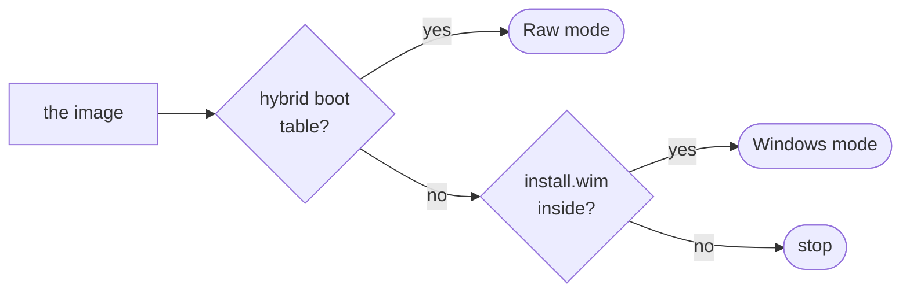

<div align="center">


### Writes a bootable USB drive from the command line

_Two commands. The same two on Windows, on macOS, and on Linux._


[](LICENSE)
[](https://github.com/Stiven-Gjekaj/burnout/releases/latest)

<p align="center">
  <a href="#overview"><b>Overview</b></a> |
  <a href="#the-two-modes"><b>Modes</b></a> |
  <a href="#how-burnout-chooses"><b>Detection</b></a> |
  <a href="#the-layout-that-windows-mode-writes"><b>Layout</b></a> |
  <a href="#the-shape-of-the-command"><b>Commands</b></a> |
  <a href="docs/milestones.md"><b>Milestones</b></a>
</p>

</div>

---

> [!NOTE]
> **Both modes are built.**
> `burnout list` and `burnout write` run on Windows, on macOS and on Linux.
> `write` reads the image first. It copies a hybrid image to a drive, flushes
> it, reads it back and compares a hash. It lays a Windows ISO out for Windows,
> and reads each file back against its own hash.
> Version 2.0.0 is out, and [Install](#install) says how to get it.
> [docs/roadmap.md](docs/roadmap.md) holds the measurements behind both
> claims.
> [docs/roadmap.md](docs/roadmap.md) says what comes next, and
> [docs/milestones.md](docs/milestones.md) holds every decision and the reason
> behind it.

---

## Overview

**Burnout** writes a disk image to a drive.
You give it an image and a drive, and it makes that drive start.

Most tools of this kind solve one half of the problem.
A byte copy writes a Linux ISO and fails on Windows.
Rufus builds a real Windows installer and runs on Windows only.
So the answer today depends on which image you hold and which computer you sit
at, and each answer has its own flags to learn.

Burnout removes the choice.
It reads the image, works out what that image needs, and does it.
The commands you type on a Mac are the commands you type on Windows, and the
image decides the rest.

<table>
<tr>
<td width="50%" valign="top">

### What it aims to do

- **Write any bootable image.** A Linux ISO, a BSD ISO, a raw `.img`.
- **Build a real Windows installer**, and not a copy of the files.
- **Hold a large install image**, with no split and no lost `install.esd`.
- **Skip the Windows 11 checks** for the TPM, Secure Boot and the RAM.
- **Skip the Microsoft account step** in Windows Setup.
- **Verify the write**, and name the check that it ran.

</td>
<td width="50%" valign="top">

### How it aims to behave

- The same commands on all three operating systems.
- No flag for a thing that the tool can work out by itself.
- It never mounts a drive, and it calls no tool of the host.
- It refuses the disk that your system starts from.
- Each error says what went wrong, and then what to do about it.
- It asks for a password through `sudo`, and never reads one itself.
- It names the target, and you confirm it, one time.

</td>
</tr>
</table>

---

## Install

On macOS or on Linux, with Homebrew:

```bash
brew install stiven-gjekaj/tap/burnout
```

On Windows, with Scoop:

```powershell
scoop bucket add stiven-gjekaj https://github.com/Stiven-Gjekaj/scoop-bucket
scoop install stiven-gjekaj/burnout
```

On Windows, with winget:

```powershell
winget install Stiven-Gjekaj.Burnout
```

With Cargo, on any of the three hosts:

```bash
cargo install burnout
```

Or download the binary for your host from the
[latest release](https://github.com/Stiven-Gjekaj/burnout/releases/latest).

The program with windows, `burnout-gui`, is a package of its own, and it
installs `burnout` with it:

```bash
brew install stiven-gjekaj/tap/burnout-gui
```

```powershell
scoop install stiven-gjekaj/burnout-gui
winget install Stiven-Gjekaj.BurnoutGUI
```
[docs/releasing.md](docs/releasing.md) says how to check it against
`SHA256SUMS` and against its build provenance.

### The warning of a download

A browser marks each file that it downloads, and macOS and Windows then warn
before they start it. The warning is about how the file arrived, and not about
what the file holds. Check the file first, and then take the mark off.

- **macOS** does not start the binary, because no paid certificate signed it.
  Take the mark off, and it starts:

  ```bash
  xattr -d com.apple.quarantine burnout-1.0.0-aarch64-apple-darwin
  ```

- **Windows** SmartScreen can show "Windows protected your PC". Select
  **More info**, and then **Run anyway**. In PowerShell, `Unblock-File` takes
  the mark off:

  ```powershell
  Unblock-File .\burnout-1.0.0-x86_64-pc-windows-msvc.exe
  ```

Homebrew, Cargo, `curl` and `gh release download` set no mark, so they bring
no warning.

---

## The program with windows

`burnout-gui` writes a drive for a person who does not use a terminal. It
lists the drives, takes the image and the drive that you choose, and shows
what it will erase. Then it asks for the same answer that the command line
asks for, and shows the progress and the result.

The program writes nothing itself. It starts `burnout write --json` with the
privilege of the host, shows the events, and passes on the answer that you
type:

- **macOS** asks for your password, or for Touch ID, in its own dialog.
- **Linux** asks through polkit, with `pkexec`.
- **Windows** asks through UAC.

So the confirmation, the refusal of the system disk and the check after the
write are the same code as on the command line. A cancel stops the write as
Ctrl+C does, and the program shows what the drive holds after it.

The program writes an image byte for byte, and lays out a Windows ISO for
Setup. Windows To Go, one partition, and the options of Setup are on the
command line only. A screen reader can choose a drive, and so can the arrow
keys.

`burnout-gui` needs `burnout` of the same version, beside it or on the path,
and refuses another version. On macOS it is a command and not an app yet:
start it from a terminal. On Linux it needs glibc 2.35 or later and
fontconfig, as a desktop has.

## The two modes

A drive gets one of two treatments.
They share the device handling and the safety checks, and they share nothing
else.

| | **Raw mode** | **Windows mode** |
| :-- | :-- | :-- |
| **For** | Linux, BSD, any hybrid ISO, any `.img` | A Windows installer ISO |
| **What it does** | Copies the image byte for byte | Partitions, formats, writes files |
| **Partition table** | Comes from inside the image | Burnout creates it |
| **Verifies by** | One hash of the device against the source | One hash for each file |
| **Proves** | The drive holds the image | Each file arrived whole |

A Linux ISO is already a bootable disk image.
It carries its own boot code, its own partition table and its own EFI system
partition inside the file, so writing it means a copy of the bytes.

A Windows ISO is not a bootable disk image.
It holds no boot code for a USB drive, so a byte copy gives a drive that most
firmware refuses.
That one difference is why Windows mode exists, and why a tool like Rufus
exists at all.

`--to-go` adds a third treatment for a Windows ISO: a drive that runs Windows
itself, in place of an installer. [Windows To Go](#windows-to-go) tells how.

---

## How Burnout chooses

You do not tell it. It reads the first 512 bytes.



A boot signature and a partition table in those 512 bytes mean a hybrid image,
so Burnout copies the bytes.
Without them, it looks inside for `sources/install.wim` or
`sources/install.esd` and builds the installer.
If it finds neither, it stops and says what it found. A file that xz, gzip,
zstd, bzip2, zip or 7-Zip made holds the image and is not the image, so
Burnout names the command that decompresses it.

`--mode raw` and `--mode windows` override the result.
They exist for the day the guess is wrong, and a normal person never types
them.

> [!NOTE]
> **Burnout runs on macOS. It does not make macOS install media.**
> Apple ships no ISO, and the supported path is `createinstallmedia`, which
> exists on macOS only. Burnout detects an `.app` bundle, an
> `InstallAssistant.pkg` or a compressed dmg and refuses with a sentence that
> names the right tool, rather than writing a drive that starts nothing. It
> is not planned, and [the milestones](docs/milestones.md) say why.
> [The roadmap](docs/roadmap.md#later-maybe) keeps it as a later maybe.

---

## The layout that Windows mode writes

```
        +=================================================================+
        |  MBR partition table                                            |
        +===============================+=================================+
        |  Partition 1                  |  Partition 2                    |
        |  FAT32, about 1 GB            |  exFAT, the rest of the drive   |
        |                               |                                 |
        |  every boot file              |  sources/install.wim            |
        |  bootmgr, efi/, boot.wim      |  or sources/install.esd         |
        |  autounattend.xml             |  whole, and never split         |
        +===============================+=================================+
                    ^                                  ^
                    |                                  |
          UEFI firmware reads this.           Windows PE reads this,
          It reads FAT only, so every         after it has started from
          boot file lives here.               partition 1.
```

Three decisions hold this together, and [the milestones](docs/milestones.md)
record the reason for each.

- **exFAT, and not NTFS.** macOS mounts NTFS read only, so an NTFS partition
  would give a Windows path that works on two hosts out of three.
- **No file is ever split.** exFAT has no 4 GiB limit, so the install image
  goes on whole. Burnout writes no WIM file, which is also why it stays MIT and
  needs no wimlib.
- **MBR, and not GPT.** Burnout writes the table itself, so the spare EFI
  partition that `diskutil` adds on macOS never appears. It also lets a BIOS
  start the drive: the MBR and partition 1 carry boot code of Burnout's own
  that loads `bootmgr`. Windows 10 Setup starts from it in QEMU with SeaBIOS.
  [P8 in the roadmap](docs/roadmap.md#p8-legacy-bios-boot) records the
  test.

---

## The shape of the command

A device path cannot be the same on three operating systems.
`/dev/disk4`, `/dev/sdb` and `\\.\PhysicalDrive2` have nothing in common.
So a device path is never the target.

```bash
burnout list
```

```
#  DRIVE                   SIZE                              BUS     REMOVABLE
1  APPLE SSD AP0512Z       500.3 GB (500,277,792,768 bytes)  Fabric  no   (system disk)
2  Samsung PSSD T7 Shield  1.0 TB (1,000,204,886,016 bytes)  USB     yes
```

The size comes twice. The rounded figure is what a person recognises from the
box, and the exact count is the number that the code can prove.
A drive is sold in powers of ten, so the rounded figure uses them too.
A drive that takes no write, such as an SD card with its lock switch on,
carries the mark `(read only)`, and `write` refuses it.

`info` reads an image and says what `write` does with it. It needs no
privilege. For a Windows ISO it lists the editions of the install image:

```bash
burnout info Win11_25H2_English_Arm64_v2.iso
```

```
image   Win11_25H2_English_Arm64_v2.iso
        8.0 GB (7,994,415,104 bytes)
volume  UDF, label CCCOMA_A64FRE_EN-US_DV9
mode    windows

The image holds an install image of Windows, so `write` lays the drive out for Windows.

install sources/install.wim, 7.1 GB, LZX compression
   1  Windows 11 Home                  ARM64  10.0.26200.8037  en-US
   2  Windows 11 Home Single Language  ARM64  10.0.26200.8037  en-US
   3  Windows 11 Pro                   ARM64  10.0.26200.8037  en-US

Setup asks for one of these editions, or write --edition chooses one.
```

```bash
burnout write ubuntu-24.04.iso 2
```

That command is identical on all three hosts.

`list` runs with no privilege, so you see your drives before you give a
password. `write` asks for one only when the drive itself refuses the write,
and it asks through `sudo` and never reads a password itself. On macOS with
no terminal, as under a program that starts it, `write` asks macOS for the
drive instead, and macOS shows its own password dialog. On Windows it says to
open a shell as Administrator, because a second console window that closes at
the end is worse than a clean refusal.

It names the drive, the size to the byte and the serial, and waits.

```
This erases the drive. Nothing undoes it.

    image   ubuntu-24.04.iso
            2.1 GB (2,109,796,352 bytes)
    drive   SanDisk Ultra
            62.5 GB (62,521,344,000 bytes)
            /dev/rdisk4 USB removable
            serial 4C530001260305117454

The image carries a boot table in its first sector.

Type yes to go on:
>
```

A drive that Burnout cannot prove is removable needs `--force`, and then the
prompt asks for the model and the size of the drive rather than one word.
Nothing allows a write to the drive that the system starts from.

An ISO records the size of its own volume, and Burnout refuses a file that is
shorter before it reads anything else. A download that stopped early leaves
such a file, and a byte copy of it would pass its own check.

```
burnout: Win11.iso holds 3,000,000,000 bytes, and its file system says that it holds 7,994,415,104. The image is incomplete. Download it again, and compare its SHA-256 with the one that its publisher gives
```

When it finishes it names the check that it ran:

```
Wrote 2.1 GB (2,109,796,352 bytes) to SanDisk Ultra.
Checked 2.1 GB (2,109,796,352 bytes) of the drive against the image, byte for byte.
SHA-256 162ba3c552a2d241c7c63ec26777af0255ee1b5a135adc0be986ceed999933ef
macOS ejected the drive, so nothing mounts it or writes to it until you connect it again.
```

The last line comes on macOS only. macOS mounts a drive as soon as nothing
holds it, and Spotlight then writes to it, so Burnout ejects the drive when
the check ends. Windows holds the drive offline after the write, so the same
place says that on Windows.

A Windows ISO takes the same command. Three options change what Setup does,
and Burnout writes nothing else into `autounattend.xml`:

- `--skip-hardware-checks` turns off the checks of Windows 11 for TPM, Secure
  Boot, RAM, CPU and storage.
- `--no-microsoft-account` takes away the step of the Microsoft account. Setup
  then asks for a local account and its password, so Burnout holds no
  password.
- `--edition` chooses the edition that Setup installs, by its index or its
  name, as `burnout info` lists them. `--edition Pro` is enough for Windows
  11 Pro. Setup then does not ask for an edition.

```bash
burnout write Win11_25H2_English_Arm64_v2.iso 3 --skip-hardware-checks --no-microsoft-account
```

With no `--edition`, Setup shows the editions in the image, and you choose
one there. The report counts the files, and names the check:

```
Wrote 963 files of 8.0 GB (7,988,543,418 bytes) to Samsung Flash Drive: 962 onto partition 1, FAT32, and 1 onto partition 2, exFAT.
Checked each file through a new mount of its volume against the SHA-256 that it went in with, and the partition table against the one that Burnout wrote.
macOS ejected the drive, so nothing mounts it or writes to it until you connect it again.
```

<details>
<summary><b>What happens inside a Windows write</b></summary>

```
burnout write Win11_25H2.iso 2
  -> reads the size that the ISO records, and refuses a file that is shorter
  -> reads the first 512 bytes, finds no hybrid table
  -> finds sources/install.wim, and selects Windows mode
  -> plans both partitions, and refuses a drive that is too small
  -> checks the privilege, and starts itself again through sudo if it must
  -> names the target drive, and waits for you to confirm it
  -> unmounts every volume on the drive
  -> writes an MBR with two partitions
  -> formats partition 1 as FAT32, and copies every boot file to it
  -> writes autounattend.xml onto partition 1
  -> writes partition 2 as exFAT, with the install image whole
  -> flushes the drive
  -> opens the drive again, and reads each file back against its hash
  -> ejects the drive on macOS
  -> reports what it checked
```

Burnout calls no tool of the host at any step above.
It writes the partition table and both file systems itself, which is the only
reason the steps are identical on three operating systems.

</details>

### One partition

`--partition` writes the image into one partition of the drive, byte for byte,
and leaves the other partitions as they are. It takes a file system image or
a raw image. A Windows ISO needs the whole drive, so Burnout refuses it here.

```bash
burnout write rescue.img 2 --partition 2
```

Burnout reads the partition table from the drive, MBR or GPT, and names the
partition in the confirmation:

```
This erases partition 2 of the drive. Nothing undoes it.

    image   rescue.img
            50.0 MB (50,000,000 bytes)
    drive   SanDisk Ultra
            62.5 GB (62,521,344,000 bytes)
            /dev/rdisk4 USB removable
    partition 2
            166.7 MB (166,723,584 bytes)
            from byte 100,663,296
            Microsoft basic data

The other partitions of the drive stay as they are.

Type yes to go on:
>
```

It reads the table again after your answer, and stops if the partition moved.
It refuses a table that is damaged, a number that the table does not hold, an
extended partition, and a partition smaller than the image. The check reads
the partition back against the image.

### Windows To Go

`--to-go` makes a drive that starts Windows itself, in place of an installer.
Burnout applies one edition of the install image to an NTFS partition, and
puts the boot files and a BCD store on an EFI system partition. The drive
starts through UEFI, and Windows then shows its first-run setup.
The image is a Windows ISO, or a WIM file that holds the edition.

```bash
burnout write Win11_25H2_English_Arm64_v2.iso 3 --to-go --edition Pro
```

`--edition` is necessary here, because no Setup runs to ask for one.

```
Burnout makes a drive of Windows To Go with edition 3, Windows 11 Pro:
    partition 1  FAT32, 314.6 MB, 104 boot files and the BCD store
    partition 2  NTFS, 42.4 GB, 127,048 files and directories, 15.1 GB of streams
The drive starts Windows through UEFI, with no Setup.
```

The drive has a GPT. Partition 1 is the EFI system partition, from 1 MiB for
300 MiB. Partition 2 goes from 512 MiB to 1 MiB before the end of the drive.
Burnout writes NTFS, the boot files and the BCD store itself, and calls no
tool of Windows. The check reads back the GPT, each boot file, and each
stream of Windows against the SHA-1 that the install image names for it.

`--bios` makes a drive that a BIOS starts, and that UEFI starts too:

```bash
burnout write Win11_25H2_English_x64_v2.iso 3 --to-go --bios --edition Pro
```

The drive then has an MBR with the boot code of Burnout, and partition 1 is
active. It holds `bootmgr` and `\Boot\BCD` for a BIOS, as `bcdboot /f BIOS`
puts them. It also holds the boot files and the store for UEFI, which name
the partitions of the MBR. Windows starts from a BIOS only on an MBR disk,
and UEFI starts Windows from an MBR disk too. So one drive serves a PC of
either kind. Without `--bios`, the drive has a GPT and starts through UEFI
only.

Limits:

- An Arm64 edition has no boot manager for a BIOS, so `--bios` refuses it.
- An `install.esd` uses LZMS, which Burnout does not read. An ISO that the
  Media Creation Tool made holds one. Burnout refuses it and prints the
  command that exports the edition to a WIM file: DISM on Windows, and
  `wimlib-imagex` on macOS and Linux. Give Burnout that file in the place of
  the ISO:

  ```bash
  dism /Export-Image /SourceImageFile:D:\sources\install.esd /SourceIndex:6 /DestinationImageFile:install.wim /Compress:max
  burnout write install.wim 3 --to-go --edition 1
  ```
- The drive can have sectors of 512 bytes or of 4096 bytes. A BIOS starts
  no drive with sectors of 4096 bytes, so `--bios` refuses such a drive with
  the error kind `bios_sector_size`.
- Measured in VMs: Windows 11 25H2 Pro of the Arm64 ISO started through
  UEFI, and Windows 11 25H2 Pro of the x64 ISO started through UEFI and
  through a BIOS, and one drive of `--bios` started through UEFI too. A
  drive with sectors of 4096 bytes started through UEFI. Each
  came to its first-run setup. On a PC with Windows,
  Hyper-V started an x64 drive with Secure Boot on, and Windows 11 came to
  its first-run setup in 5 minutes. The `install.esd` of the Media Creation
  Tool for Windows 10, exported with the DISM command above, did the same.

### A write that stops

Burnout resumes nothing, and it promises nothing about a write that stops.
It says what the drive holds, after an error and after Ctrl-C alike:

```
burnout: stopped. The write did not end, so the drive holds part of the image, and it is not usable now. Write the image again
```

A stop during the check says that the drive holds the whole image and that
Burnout did not complete the check. A stop before the write says that Burnout
wrote nothing. After a signal, the exit code is 128 and the number of the
signal, as a shell gives it, and 130 on Windows. A signal that the parent
ignores stays ignored, so a write under `nohup` goes on to its end.

### For a script

`--json` prints JSON on the output stream, and the text for a person goes to
the error stream. `list` and `info` print one object each:

```bash
burnout list --json
```

```
{"drives":[{"number":1,"id":"disk0","node":"/dev/rdisk0","name":"APPLE SSD AP0512Z",...,"system":true,"read_only":false},...],"system_disk_known":true}
```

`write` prints one object on each line. The confirmation still reads its
answer, so a script gives the answer that the confirm event names:

```bash
printf 'yes\n' | burnout write ubuntu-24.04.iso --device /dev/sdb --json
```

```
{"event":"confirm","image":{"path":"ubuntu-24.04.iso","size_bytes":2109796352},"mode":"raw","drive":{...},"expects":"yes"}
{"event":"start","stage":"unmount","total_bytes":null}
{"event":"done","stage":"unmount","bytes_done":0}
{"event":"start","stage":"write","total_bytes":2109796352}
{"event":"progress","stage":"write","bytes_done":536870912,"total_bytes":2109796352}
...
{"event":"result","mode":"raw","image_bytes":2109796352,"written_bytes":2109796352,"checked_bytes":2109796352,"sha256":"162ba3c5...","ejected":true,"offline":false}
```

An error prints `{"event":"error","kind":"in_use","message":"...","note":null}`,
and a stop prints `{"event":"stopped","reached":"writing","message":"..."}`.
Test the `kind`, and not the message: the message is for a person, and it can
change.

A program that cannot send Ctrl+C to `burnout` gives `--stop-on-input`.
`pkexec` runs `burnout` as root, for example. After the answer, the word
`stop` on the input, or the end of the input, then stops the write as Ctrl+C
does, with the exit code 130. Without the option, an input that ends does not
stop the write, so `printf 'yes\n' | burnout write ...` works as before.

On Windows, a program that starts `burnout` through UAC gets none of its
streams. The program makes two named pipes, `\\.\pipe\NAME.out` and
`\\.\pipe\NAME.in`, and starts `burnout write ... --json --pipe NAME`.
The events then come through the first pipe, and the answer goes in through
the second. When the program writes `stop` into the second pipe, or closes
it, `burnout` stops as it does for Ctrl+C.

---

## Safety

> [!WARNING]
> **Burnout erases the drive that you give it.**
> The erased data goes nowhere, and no undo exists. A wrong target, a drive
> that fails during the write, and a cable that comes loose all give the same
> result, and none of them is recoverable. Keep a backup of anything you value.
> Read [TERMS.md](TERMS.md) section 4 before you run it.

What the code must never do, from
[CONTRIBUTING.md](CONTRIBUTING.md):

- Write to a device that the person did not select and confirm.
- Write to the disk that the running system starts from.
- Treat a fixed disk as a removable one.
- Report a verification pass that it did not run.
- Hide the target behind a default. The person names the target every time.

**You supply the operating system.**
Burnout downloads no operating system, hosts none, and gives you a licence for
none.
A Windows installation needs a licence from Microsoft.

---

## Project documents

| Document | What it holds |
| :-- | :-- |
| [docs/roadmap.md](docs/roadmap.md) | The order the work happens in, and the exit test for each phase |
| [docs/milestones.md](docs/milestones.md) | Every decision, the reason for it, and the options that lost |
| [docs/releasing.md](docs/releasing.md) | How a release is cut, and how to check a download |
| [CONTRIBUTING.md](CONTRIBUTING.md) | How to take part, and the rule that no test opens a real device |
| [AGENTS.md](AGENTS.md) | The rules for anybody who changes this repository, human or agent |
| [SECURITY.md](SECURITY.md) | The threat model, and how to report a vulnerability privately |
| [TERMS.md](TERMS.md) | What the tool does to your data, and what you agree to |
| [SUPPORT.md](SUPPORT.md) | Where to ask a question |
| [CODE_OF_CONDUCT.md](CODE_OF_CONDUCT.md) | Applies to everybody who takes part |

---

## What the spike proved

Both open questions are answered, against a running Windows 11 Setup.
[docs/spike-layout.md](docs/spike-layout.md) holds the evidence.

- **Windows PE reads exFAT.** It mounted the exFAT partition as `D:` and
  walked its directory tree. The layout above stands.
- **Setup does not find the install image across the partition boundary.**
  The volume was mounted and readable, and Setup still reported a missing
  media driver. So the `InstallFrom` path in `autounattend.xml` is a
  **requirement**, not insurance, and Burnout writes that file on every
  Windows drive whether or not anybody asks for an option.
- **The hardware checks come off from the same file.** Five `LabConfig`
  commands, and the refusal screen for TPM 2.0 and Secure Boot never appears.

One risk came out of it: the path holds a drive letter, and Windows PE assigns
letters itself. The milestones record what to do about that.

---

## Licence

MIT. See [LICENSE](LICENSE) and [TERMS.md](TERMS.md).

`burnout-gui` uses [Slint](https://slint.dev) under the Slint Royalty-free
Desktop, Mobile, and Web Applications License. **Help > About** shows the
attribution that the licence asks for.

<div align="center">
<sub>Burnout erases drives. Read the warning above before you run it.</sub>
</div>
